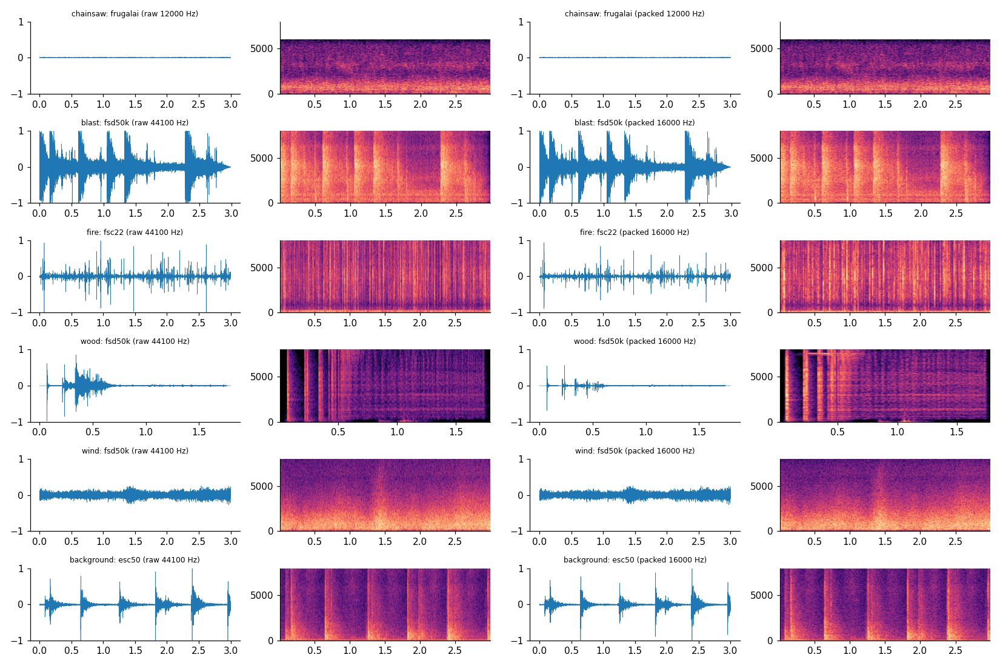
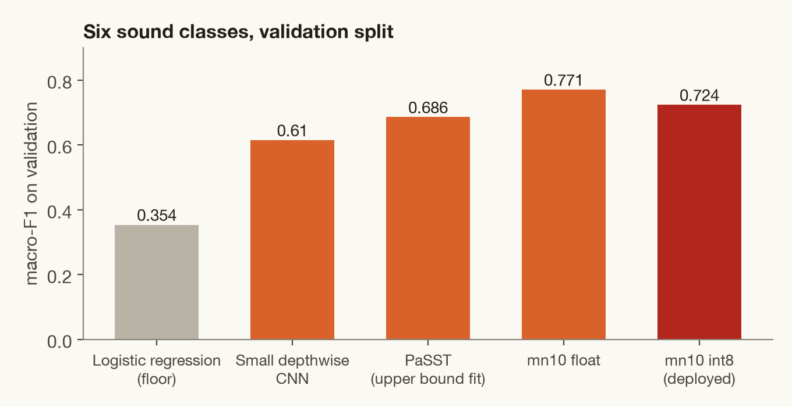
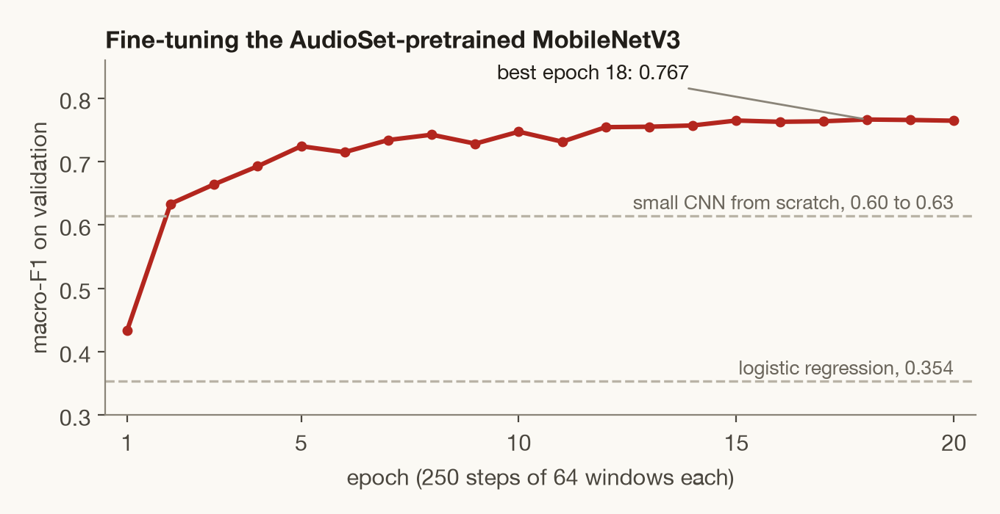
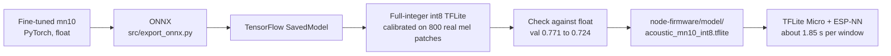
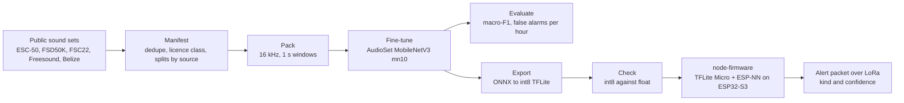

<div align="center">

# A sound classifier for forest lookout stations

**Chainsaw or blast? A microphone on a ridge tells the control room to check.**<br>
A six-class classifier: an AudioSet-pretrained MobileNetV3, fine-tuned on 43,055 clips and shrunk to a 4.3 MB int8 model that runs on an ESP32-S3 in 1.85 s.

[Design](docs/design.md) &nbsp;·&nbsp; [Plan and pass targets](docs/plan.md) &nbsp;·&nbsp; [Corpus summary](manifests/SUMMARY.md) &nbsp;·&nbsp; [Speed test on the chip](board-bench/RESULTS.md) &nbsp;·&nbsp; [Station firmware](https://github.com/Terra-Watch/node-firmware)




<sub>One clip of each class: chainsaw, blast, fire, wood noise, wind, background. Left: as downloaded. Right: as packed for training.</sub>

</div>

---

A station's alert is a **"check" item for a person, never a confirmed event**.

## Classes and alert rules

| Class | What it covers | What the station does |
|---|---|---|
| **chainsaw** | Chainsaws at work | Alert when at least 2 of the last 3 one-second windows within 60 s are above the threshold |
| **blast** | Gunshots and fireworks together | Alert on a single window |
| **fire** | Any open flame | Logged. The firmware alerts only at a high threshold: 2 of the last 3 windows, at most once per 10 minutes |
| **wood** | Wood noise | Logged |
| **wind** | Wind on the microphone | Logged, and the microphone is marked blind |
| **background** | Other sounds | Nothing |

Reasoning and open questions: [`docs/design.md`](docs/design.md). Phases, decision rules and pass targets: [`docs/plan.md`](docs/plan.md).

## Results so far

Validation and in-domain test. **These are not field results.**

<table>
<tr>
<td width="54%" valign="top"></td>
<td width="46%" valign="top">

| Model | Val | Test (in-domain) |
|---|---|---|
| Logistic regression on spectrum features | 0.354 | 0.332 |
| Small depthwise CNN, 3 seeds | 0.60 to 0.63 | 0.57 to 0.59 |
| PaSST, fitted as the upper bound | 0.686 | |
| Fine-tuned `mn10`, float | 0.771 | 0.733 |
| **`mn10`, int8 (deployed)** | **0.724** | **0.694** |

Macro-F1 over six classes. The deployed int8 model agrees with the float model on 94% of validation windows and 89% of test windows. A per-channel int8 export reaches 0.733 and 0.702 but is 4.75 MB instead of 4.3 MB.

</td>
</tr>
</table>

### On the chip

| | |
|---|---|
| **Deployed model** | `mn10`, a MobileNetV3 pretrained on AudioSet, int8, 4,307,368 bytes, input 106 mel bands by 100 frames (1 s of audio) |
| **Time per classification** | About 1.85 s on an ESP32-S3 with ESP-NN |
| **What made it possible** | ESP-NN's assembly kernels are 10 to 25 times faster than reference kernels on the same chip, and channel counts in multiples of 8 matter as much as model size ([`board-bench/RESULTS.md`](board-bench/RESULTS.md)) |
| **Front end** | A C++ mel front end, checked against the Python reference (`src/frontend_ref.py`, `src/frontend_check.py`) |

### Open problems, stated plainly

- **Unseen sources.** On recordings from sources the model has not seen (`test_ext`), scores are clearly lower: the small CNN drops from 0.58 to between 0.32 and 0.37.
- **False alarms.** The target is at most 1 per hour. On held-out forest background the measured rate is in the hundreds per hour for the models in `runs_cloud/*/eval.json`. The thresholds in the firmware are starting points, not calibrated in the field.
- **No field test yet.** A published forest gunshot model lost much precision at an unseen site. A test with the forest department (a chainsaw at 50 to 400 m, a prescribed burn, per-site thresholds) has not been done.
- **Thin classes.** Chainsaw has 634 training items from four sources. Fire audio is mostly campfire-type, with three real wildfire recordings.

## The model: MobileNetV3, fine-tuned

A small CNN trained from scratch tops out near 0.6 macro-F1 on this corpus, because 43,000 clips are few for learning what a forest sounds like. So the station model starts from a network that has already heard a lot: **`mn10`, the full-width MobileNetV3 of [EfficientAT](https://github.com/fschmid56/EfficientAT) (Schmid et al.), pretrained on AudioSet**, and is fine-tuned on the six classes.

<table>
<tr>
<td width="50%" valign="top">

| | |
|---|---|
| **Architecture** | MobileNetV3: inverted-residual blocks with depthwise convolutions, squeeze-and-excitation and hard-swish; width multiplier 1.0 |
| **Parameters** | About 4.2 million |
| **Pretraining** | AudioSet; the classifier head is replaced by a six-way head |
| **Input** | 1 s of audio as a log-mel spectrogram from the pretrained front end (800-sample window, 320-sample hop at 32 kHz, 128 bands), keeping the lowest 106 bands because the bands above 8 kHz are empty for 16 kHz audio. Hop 10 ms, so 106 x 100 |
| **Output** | Six probabilities: chainsaw, blast, fire, wood, wind, background |
| **Smaller widths** | `mn01` to `mn05` can be chosen with `--model` and `--width` in `src/finetune.py` |

</td>
<td width="50%" valign="top"></td>
</tr>
</table>

### How it is fine-tuned

`src/finetune.py`, one command: `python src/finetune.py --model mn10_as --epochs 20`.

| Part | Setting |
|---|---|
| **Optimiser** | AdamW, learning rate 3e-4, weight decay 0.01, one-cycle schedule with a 15% warm-up |
| **Length** | 20 epochs of 250 steps, batches of 64 one-second windows; the epoch with the best validation macro-F1 is kept |
| **Loss** | Cross-entropy with label smoothing 0.05 |
| **Sampling** | Class chosen uniformly, then source uniformly within the class, then an item, so a big source (Belize background) cannot drown the small ones |
| **Mixing** | An event is mixed into a real background clip with probability 0.5 at 5 to 20 dB signal-to-noise, so the model learns events in forest noise |
| **Microphone variation** | With probability 0.7 a random smooth frequency response (about 4 dB, 100 Hz to 7.5 kHz) imitates different microphones and enclosures; an optional random gain stops loudness from deciding the class |
| **SpecAugment** | Random frequency and time masks on the mel spectrogram |
| **Selection** | The epoch is picked on validation only. Test and external sources are scored afterwards, with thresholds taken from validation |
| **Distillation** | The script can also train a small model against a fine-tuned larger one (`--teacher`); the deployed model is the direct fine-tune |

Fine-tuning gains about 0.15 macro-F1 over the small CNN trained from scratch with the same sampler and augmentations, and the curve passes the CNN after two epochs.

### From PyTorch to the chip



Quantisation costs about 0.05 macro-F1 on validation (0.771 to 0.724) and 0.04 on the in-domain test split (0.733 to 0.694). The mel front end on the chip is a C++ port checked against the Python one (`src/frontend_ref.py`, `src/frontend_check.py`).

## The corpus

Built from public sound collections: ESC-50, FSD50K, FSC22, Freesound, a Belize forest soundscape set and several smaller sets, plus targeted Freesound searches.

| Class | Train (min) | Val | Test in-domain | Test external | Items |
|---|---|---|---|---|---|
| chainsaw | 80.1 | 9.1 | 7.6 | 6.6 | 919 |
| blast | 112.6 | 20.9 | 27.9 | 10.6 | 2,686 |
| fire | 138.6 | 23.5 | 18.0 | 15.4 | 573 |
| wood | 113.2 | 15.9 | 12.3 | 0 | 998 |
| wind | 64.3 | 8.3 | 6.8 | 0 | 499 |
| background | 1,743.6 | 213.4 | 208.8 | 644.4 | 37,380 |

43,715 items were listed and **43,055 are usable** after removing duplicates, label conflicts, leaks between splits and unreadable files. Splits are by recording source, so a held-out test source is never heard in training.

> **No audio is stored in this repository.** The licences differ per source (open, unknown, non-commercial). `manifests/` lists every item with its source and licence class, and `scripts/` fetches and packs the audio on your machine. For any product use, train on open-licence items only.

## From clip to station



## Layout

| Path | Content |
|---|---|
| `docs/design.md`, `docs/plan.md` | Design, classes, data and licences, evaluation, phases and go/no-go gates |
| `scripts/` | `01`-`06` download metadata and sets, `10` manifest, `11` pack corpus, `12` targeted Freesound, `20` notebook, `21` 8 kHz cache, `30`/`31` launch and run jobs on cloud VMs, `40` soundscapes, `50` front-end header for the firmware |
| `src/` | Data loading, features, models, training, fine-tuning, evaluation with false alarms per hour, export to ONNX and TFLite, sliding-window and triggered evaluation |
| `manifests/` | Item lists, licence classes, summary, listening-check lists (no audio) |
| `runs/`, `runs_cloud/` | Evaluation outputs and logs of the runs (checkpoints are not kept in git) |
| `board-bench/` | The ESP32-S3 speed test and its results |
| `cloud/` | The job script for the GPU VMs and notes on them |
| `notebooks/`, `reports/` | The raw-to-processed notebook and its figures |
| `tests/` | `test_core.py` |

## Run

```bash
python3 -m venv .venv && . .venv/bin/activate
pip install numpy scipy soundfile librosa torch torchaudio timm scikit-learn pandas pyyaml tqdm
python scripts/10_build_manifest.py        # needs the fetched audio under data/
python src/train.py --model student_ir --seed 0 --out runs/student_ir_s0
python src/evaluate.py --help
```

The cloud scripts (`scripts/30_launch.py`, `31_fleet.py`) read a project-to-account map from a local file outside git (`~/.config/terrawatch/gcp_projects.md`, or the path in `GCP_PROJECT_MAP`) and are not meant to run on their own. There is no lock file yet; the package list above is what the scripts import.

---

<sub>Part of <a href="https://github.com/Terra-Watch">TerraWatch</a>: <a href="https://github.com/Terra-Watch/node-firmware">station firmware</a> · <a href="https://github.com/Terra-Watch/relay-firmware">relay</a> · <a href="https://github.com/Terra-Watch/gateway-firmware">gateway</a> · <a href="https://github.com/Terra-Watch/dashboard">dashboard</a> · <a href="https://github.com/Terra-Watch/terrawatch-datasets">datasets</a></sub>
